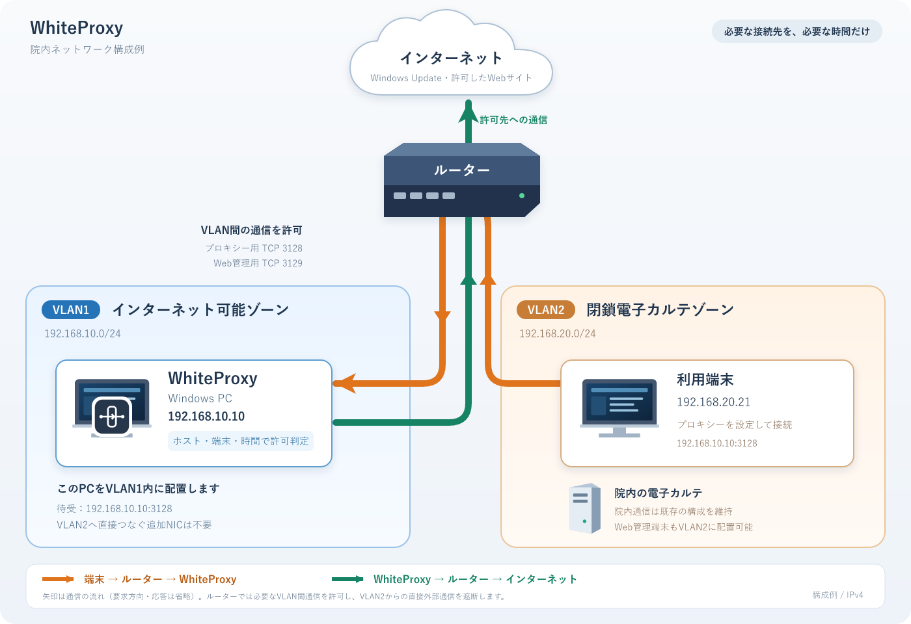

# WhiteProxy

院内の閉鎖ネットワークにある端末から、必要なWebサービスだけを、必要な時間だけ利用するためのWindows用プロキシーです。Windows Updateなどの接続先を登録し、端末ごとに許可・遮断を切り替えます。

**初めて使う方は [導入・操作ガイド](docs/user-guide.md) をお読みください。** VLAN1をインターネット可能ゾーン、VLAN2を閉鎖電子カルテゾーンとした例で、設置から日常操作まで説明しています。

1. 院内VLAN構成例とWhiteProxyの配置
2. RTX830のVLAN間通信設定
3. WhiteProxyのインストール
4. Windowsサービス・Firewallの登録と確認
5. 許可サービスの追加
6. ルールの追加、一時許可、遮断、ログの確認
7. Webコントロール

配布版の `WhiteProxy.exe` を使用します。インストーラーや.NETの追加インストールは不要です。初回登録にはWindowsの管理者権限が必要です。

| 用途 | 初期値 |
| --- | --- |
| プロキシー接続 | TCP 3128 |
| ブラウザーからの管理 | HTTPS / TCP 3129（初期は無効） |
| 一時許可 | 4時間（設定で変更可能） |
| 初期の許可サービス | Windows Updateのみ |

初期状態では端末・ルールが未登録のため通信は許可されません。WhiteProxyを通らない直接通信は、ルーター側で制限します。

詳しい情報：[Webコントロール](docs/web-control.md) / [端末・Windows Updateの設定](docs/client-setup.md) / [運用手順](docs/operations.md)

開発・構築担当者向け：[ビルド・発行と実装の詳細](docs/development.md) / [構成](docs/architecture.md) / [セキュリティ](docs/security.md) / [テスト](docs/test-plan.md)
